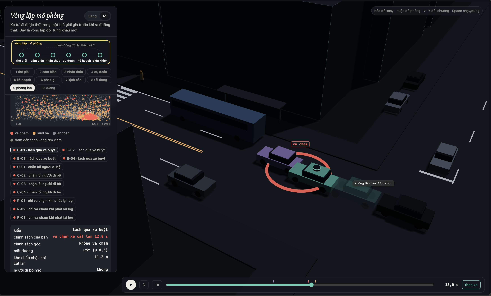
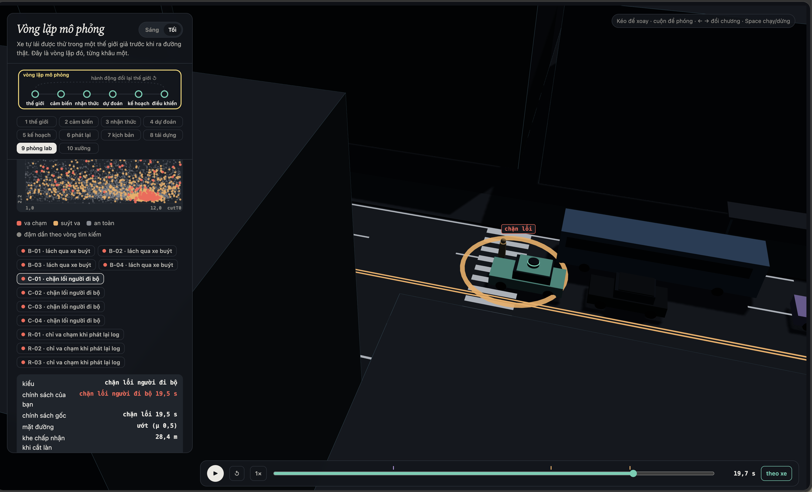
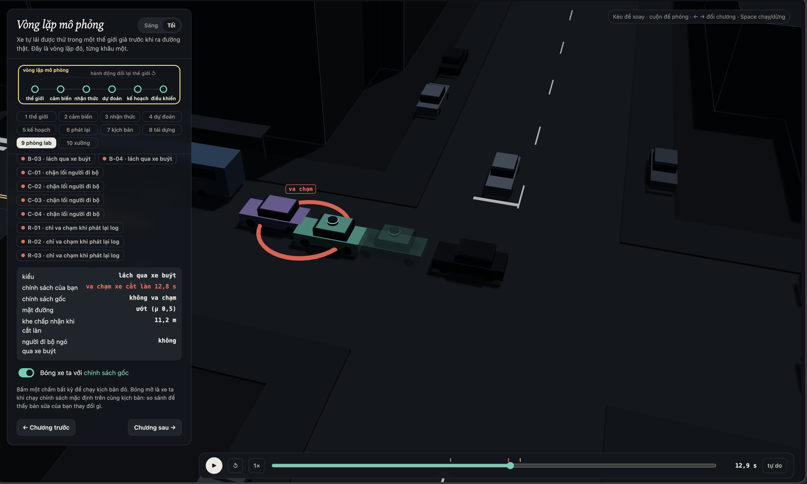
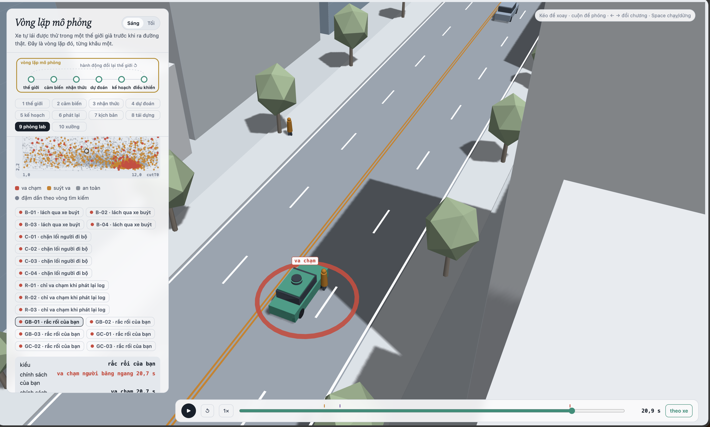

MSSV: 2A202602803

# Lab 11 · Scenario Forge — báo cáo

Mọi số trích từ `evidence/` (tên file: trường). Số nào lấy từ lần chạy thêm ngoài `evidence/` được ghi rõ là **[chạy thêm]**.

Thị trấn của bạn (`meta.json: _run.town`): **B** (thị trấn "mưa nhiều": `p(wet) = 0.30`). Mọi bước chạy không `--quick` (`meta.json: steps.*.quick = false`).

## 1. Phát lại log có trung thực không? (bước A)

| `replay.json` | Giá trị |
|---|---|
| `n` / `n_used` | 400 / 400 |
| `dropped_human_crash_logs` (log người lái tự gây va chạm) | 0 |
| Planner trên log phát lại: `replay.crashes` | **105** (`rear` 98, `side` 7) |
| Planner trong thế giới phản ứng: `reactive.crashes` | **0** |
| `crash_in_both` | 0 |

Va chạm của "phát lại" gần như toàn là `rear`, và đó là va chạm **giả**. Planner thận trọng hơn người lái: nó giảm tốc sớm khi tới gần vạch qua đường bị xe buýt che. Nhưng xe bám đuôi (TG) chạy đúng quỹ đạo đã ghi trong log, mà log được ghi khi người lái **không** chậm lại. Vì vậy TG không phanh, vì log không biết planner phanh sớm hơn người lái. Trong thế giới phản ứng, TG là IDM nên giữ khoảng cách và không có vụ nào (`reactive.crashes = 0`, `crash_in_both = 0`).

Ví dụ `replay_only[0]` (`scenario 3`, `contact = rear`, `min_ttc_reactive = 2.83 s`), xem lại **[chạy thêm]**:
- Planner chậm hơn người lái từ khoảng t = 8.3 s (x ≈ 55 m).
- Lúc 16.3 s, người lái trong log đang chạy 10.5 m/s ở x = 138 m, còn planner đã giảm xuống 1.6 m/s ở x = 113 m.
- TG theo log vẫn chạy 5.4 m/s và đâm vào đuôi xe ta.
- Trong thế giới phản ứng, cùng kịch bản đó TG giảm còn 4.5 m/s và cách xe ta 10.9 m.

## 2. Kịch bản bất khả thi (bước B)

Các luật trong `feasible.is_feasible` (μ = `mu`, g = 9.81):

| Luật | Căn cứ vật lý |
|---|---|
| `(π/cutDur)² · 3.5/2 > μg` thì loại | Chuyển làn 3.5 m theo đường cosin cần gia tốc ngang cực đại như vậy. Lốp không tạo được lực ngang vượt μg, nên xe sẽ trượt chứ không chuyển làn được |
| `cutBrake > μg` thì loại | Gia tốc phanh tối đa bị giới hạn bởi ma sát lốp–đường |
| `pedV > 2.5 m/s` thì loại | Người đi bộ đi nhanh nhất khoảng 2–2.5 m/s; trên mức đó là chạy, không còn là "người đi bộ qua đường" |
| `cutV ∉ (0, 22]` thì loại | Xe đứng yên không chuyển làn được; trên 22 m/s (~80 km/h) là phi thực tế trên phố đô thị |

Số kịch bản bất khả thi bị bỏ trong `hunt.json`:
- `bus_bypass`: 3
- `crosswalk_block`: 3
- `cut_in`: 2
- `rear_ended`: 2

Tất cả nằm ở vòng 1–3 (`trace[*].infeasible`), khi đề xuất q còn rộng. `mc.json: infeasible = 11` trên 3 000 lần chạy.

**[chạy thêm]** Trong cuộc săn mới của bước `fix` (log console, không lưu trong `fix.json`), cuộc săn `crosswalk_block` nhắm vào policy đã sửa bỏ tới 5–10 kịch bản bất khả thi mỗi vòng ở vòng 4–7.

**Vì sao CEM bị kéo về phía bất khả thi:** điểm nguy hiểm thưởng cho kịch bản "khó" nhất, mà kịch bản khó nhất thường là kịch bản vật lý không cho phép:
- chuyển làn cực ngắn (`cutDur` nhỏ) thì TTC nhỏ nhất;
- phanh mạnh hơn μg thì xe sau không kịp;
- người đi bộ chạy thì khoảng phanh còn lại âm.

Elite sẽ đầy những kịch bản này, và q co về vùng không tồn tại ngoài đời. Nếu **đếm** chúng là va chạm, ước lượng P bị đẩy cao bằng những thất bại không thể xảy ra. Các kiểu thất bại tìm được cũng mất ý nghĩa: planner bị "sửa" để chống những tình huống không có thật.

## 3. Monte Carlo cho bạn biết gì (bước C1)

`mc.json`: k = **8**, n = **3 000**, p̂ = **2.67e-3**, Wilson 95 % **[1.35e-3, 5.25e-3]**. Cả 8 vụ đều là `bus_bypass` (`modes`).

Muốn khoảng ±20 % quanh p, cần n ≈ 1.96²·(1 − p)/(0.2²·p) ≈ 96/p ≈ **36 000** lần chạy (tính với p̂ = 2.67e-3), gấp 12 lần ngân sách hiện có.

Các kiểu **chưa xuất hiện** trong 3 000 lần chạy là `cut_in`, `crosswalk_block`, `rear_ended` và `other` (`per_mode.*.k = 0`). Không được báo 0 cho chúng. Con số đúng là cận trên Wilson 95 %: **p < 1.28e-3** (`per_mode.*.hi`), tương đương quy tắc 3/n = 1e-3.

## 4. Importance sampling, ESS và độ suy biến (bước C3)

`estimate.json`, n = 600 mỗi kiểu mỗi seed:

| Kiểu | Seed | `p` | `hits` | `ess` | `top_share` |
|---|---|---|---|---|---|
| bus_bypass | 0 | 2.48e-3 | 47 | 132 | 0.48 |
| bus_bypass | 1 | 5.90e-4 | 40 | 142 | 0.28 |
| bus_bypass | 2 | 5.87e-4 | 49 | 122 | 0.27 |
| crosswalk_block | 0 | 8.0e-7 | 95 | 116 | 0.30 |
| crosswalk_block | 1 | 3.7e-6 | 90 | 118 | **0.86** |
| crosswalk_block | 2 | 1.1e-6 | 98 | 110 | **0.63** |
| cut_in | 0 / 1 / 2 | 0 → cận trên `upper_zero_hits` **0.025** | 0 | 128 / 128 / 113 | — |
| rear_ended | 0 / 1 / 2 | 0 → cận trên `upper_zero_hits` **0.025** | 0 | 128 / 121 / 126 | — |

`total` theo seed: 2.48e-3 / 5.93e-4 / 5.89e-4, **trung vị 5.93e-4**. `other`: k = 0/3000, cận trên 1.28e-3 (`other.source = mc.json`).

**Ba seed có đồng ý không?** Không hẳn.
- `bus_bypass`: seed 1 và 2 khớp nhau (5.9e-4), seed 0 cao gấp khoảng 4 lần với `top_share = 0.48`. Gần một nửa ước lượng của seed 0 do một mẫu mang.
- `crosswalk_block`: chênh nhau 4.6 lần (8e-7 đến 3.7e-6).

**So với Monte Carlo:** MC cho `bus_bypass` 2.67e-3 [1.35e-3, 5.25e-3]. Seed 1 và 2 của IS (5.9e-4) nằm **dưới** cận dưới Wilson. Đây đúng là bẫy 2 trong README: IS ở ngân sách này thường thấp hơn thật 1.5–4 lần. Với `crosswalk_block`, MC 0/3000 (< 1.28e-3) không mâu thuẫn với IS (~1e-6). Nhưng theo bẫy 3, cuộc săn có thể chỉ tìm được cách chặn lối *dễ nhất*, không phải cách hay xảy ra nhất. Nên con số 1e-6 chỉ cho biết có ít nhất chừng đó, không chứng minh kiểu này hiếm đến vậy.

**`top_share` > 0.5** ở `crosswalk_block` seed 1 (0.86) và seed 2 (0.63). Khi một mẫu mang hơn nửa tổng w·y, ước lượng thực chất là trọng số p/q của **một** kịch bản. Thêm hoặc bớt mẫu đó thì con số đổi vài lần, và se tính từ mẫu cũng không bắt được điều này. Ngược lại, `top_share` thấp không chứng minh ước lượng đúng: q có thể bỏ sót hẳn một vùng va chạm.

**Ngân sách:** IS dùng `budget` = **16 800** lần chạy, gồm cả 4 cuộc săn. Để Monte Carlo đạt cùng sai số tương đối (se/p) **[chạy thêm, tính từ `p`, `se` trong `estimate.json`]**:
- `bus_bypass` seed 2 (se/p = 0.33): MC cần khoảng **1.6e4** lần chạy, ngang ngân sách IS. Kiểu này không đủ hiếm để IS có lợi.
- `crosswalk_block` seed 2 (se/p = 0.64): MC cần khoảng **2.1e6** lần chạy, gấp khoảng 125 lần ngân sách IS. Với seed 0 (se/p = 0.36) con số là khoảng 9.5e6.

**`other`** là phần va chạm không thuộc kiểu nào. Nó không có điểm nguy hiểm riêng để CEM leo theo, vì đó là một lớp "còn lại" không đồng nhất. Nên phần của nó lấy từ Monte Carlo C1: 0 vụ trên 3 000, cận trên 1.28e-3.

## 5. Các kiểu thất bại (bước C2 + 3D)

**`bus_bypass`, lách qua xe buýt** (B-01, va chạm lúc 12.8 s):

Đường ướt (μ = 0.5). Xe tím C2 ở làn bên muốn chuyển sang làn xe ta, nhưng bị xe buýt đỗ chắn. Nó lách qua xe buýt, chậm dần rồi gần như dừng hẳn (x ≈ 96 m, v ≈ 0), với thân xe lấn dần sang làn xe ta.

Policy gốc chỉ coi C2 là "xe phía trước" khi độ lệch ngang xuống dưới `cutinLat` = 2.15 m. Điều đó xảy ra lúc 11.8 s, khi C2 chỉ còn cách khoảng 8 m. Xe ta phanh hết mức đường ướt cho phép (−4.9 m/s² = μg) nhưng vẫn đâm vào C2 ở 2.3 m/s (`contact = front`). Chi tiết thời gian lấy từ **[chạy thêm]** trên đúng kịch bản B-01.

**`crosswalk_block`, chặn lối người đi bộ** (C-01, chặn lối lúc 19.5 s):

Đường ướt (μ = 0.5), người đi bộ **không ngó** qua xe buýt (`pedLook = 0`) và chấp nhận khe thời gian ngắn (`pedGap` ≈ 1.9 s). Người đi bộ bước xuống khi xe ta đã tới gần. Xe ta phanh ở mức μg của đường ướt và dừng được, nhưng thân xe nằm trên vạch qua đường. Người đi bộ phải đứng lại trước mũi xe, nên đây là sự kiện `block`.

**Kiểu cuộc săn không tìm thấy:**
- `cut_in`: cuộc săn riêng chỉ tìm ra `{"bus_bypass": 21}` (`hunt.json: cut_in.found`).
- `rear_ended`: cuộc săn riêng chỉ tìm ra `{"bus_bypass": 1, "crosswalk_block": 4}`.

Tôi tin ở mức **trung bình** rằng hai kiểu này hiếm, nhưng không tin là chúng không có. Cận trên hiện có còn lỏng:
- Monte Carlo: < 1.28e-3.
- IS: < 0.025 (`upper_zero_hits`).

Hai cuộc săn này cũng không hội tụ: `stopped_tightening = false`, `level` dừng ở −3.4 và −1.2.

**Nếu chỉ chạy một cuộc săn chung:** CEM sẽ co về kiểu dễ tìm nhất, ở đây là `bus_bypass`. Bằng chứng là ngay cả cuộc săn nhắm vào `cut_in` cũng trôi sang `bus_bypass` (21 vụ). Cuộc săn `bus_bypass` tìm được 207 vụ, còn Monte Carlo thấy 8/8 vụ đều là `bus_bypass`. Một cuộc săn chung sẽ lặp mãi kiểu đó và bỏ sót `crosswalk_block`, kiểu chỉ xuất hiện khi có điểm nguy hiểm riêng (khoảng phanh còn lại trước người đi bộ).

## 6. Sửa planner (bước E + 3D)

Policy được chọn: **`{"cutinLat": 3.0}`** (`fix.json: chosen.policy`), chọn bằng `choose_policy` trên TRAIN.

| | `fail` | `fail_hi_seen` | `fail_hi` | `unseen` | quãng đường (m) | phanh gấp (frame) |
|---|---|---|---|---|---|---|
| Policy gốc, TRAIN | 5.34e-4 | 1.16e-3 | 1.16e-3 | — | 215.1 | 7.99 |
| Bản sửa, TRAIN | 8.38e-7 | 1.61e-6 | 1.61e-6 | bus_bypass | 215.1 | 7.46 |
| **Bản sửa, TEST** | **2.07e-5** | **5.88e-5** | **3.88e-2** | bus_bypass | 214.4 | 8.03 |
| **Policy gốc, TEST** | **4.13e-4** | **6.72e-4** | **1.95e-3** | — | 214.5 | 8.31 |

Con số để báo cáo là con số TEST. TRAIN chỉ dùng để sàng lọc, vì mẫu TRAIN được rút ở nơi *policy gốc* thất bại.

**Vì sao `fail_hi` của bản sửa (3.88e-2) lớn hơn cả `fail` của policy gốc (4.13e-4) dù bản sửa tốt hơn thật:** trên TEST, cuộc săn mới không tìm được vụ `bus_bypass` nào, nên kiểu này là `unseen`. Cận trên 95 % hợp lệ cho nó là `upper_zero_hits = 3/(0.2·400) = 0.0375`, cộng thêm cận của va chạm khác (`other_crashes.hi` = 1.28e-3). Dữ liệu cho thấy bản sửa xoá được `bus_bypass` (`fail_hi_seen` 5.88e-5 so với 6.72e-4). Nhưng với n = 400, không thể **chứng nhận** một kiểu đã biến mất dưới khoảng 4e-2. Muốn chứng nhận p < 1e-3 cần cỡ 15 000 lần chạy trên đúng vùng đó.

Cũng lưu ý: `crosswalk_block` của bản sửa trên TEST (2.07e-5) cao hơn của policy gốc (5.22e-6). Bản sửa không đụng tới người đi bộ, nên khác biệt này là nhiễu, và `top_share = 0.935` xác nhận điều đó.

Quãng đường gần như không đổi (214.4 so với 214.5 m) và số frame phanh gấp giảm nhẹ (8.03 so với 8.31).

Kịch bản B-01 lúc 12.9 s. Xe đặc là **policy gốc**, đâm C2 lúc 12.8 s. **Bóng mờ là bản sửa** `cutinLat 3.0`: dừng sau C2 gần một thân xe, không va chạm. Vì kịch bản được tìm ra dưới policy gốc, trình xem cho xe đặc chạy policy gốc và vẽ bản sửa làm bóng mờ; nhãn "chính sách của bạn" / "chính sách gốc" trong bảng bên trái là đảo của điều này. Với `cutinLat` = 3.0, planner coi C2 là xe phía trước từ 10.95 s thay vì 11.8 s **[chạy thêm]**, đủ để dừng kịp trên đường ướt.

**Núm "nghe thì an toàn" nhưng phản tác dụng: `T` = 2.0** (giữ khoảng cách thời gian lớn hơn). Trên TRAIN, `fail` = **5.30e-3**, gấp khoảng **10 lần** policy gốc (5.34e-4). Số hit cũng tăng: `bus_bypass` 38 so với 30, `crosswalk_block` 71 so với 53.

Lý do là thế giới phản ứng lại. Khe trống trước xe ta rộng hơn, nên xe chuyển làn (gap acceptance với `cutGap` trung vị 12 m) **chấp nhận chen vào** nhiều hơn. **[chạy thêm]** Trên 1 500 kịch bản tự nhiên, tỉ lệ C2 trở thành xe phía trước của xe ta tăng từ 19.6 % lên 26.8 % khi T = 2.0. Xe ta "lịch sự" hơn thì bị chen nhiều hơn, mà mỗi lần bị chen ở cạnh xe buýt là một cơ hội cho `bus_bypass`.

`cautionV` = 6.5 cũng tệ hơn trên TRAIN (5.23e-3). Nhưng `top_share` của nó là 0.79, nên con số đó có thể chỉ là nhiễu do một mẫu.

## 7. Từ mô phỏng ra đường thật

| Giả định trong `space.py` | Dữ liệu thật thay nó | Nếu giả định sai, con số sai theo hướng nào |
|---|---|---|
| **Khe chấp nhận của xe chuyển làn** `cutGap` ~ lognormal, trung vị 12 m, và `cutDur` trung vị 4 s | Quỹ đạo xe từ drone hoặc camera cao: highD (Krajewski et al., 2018), NGSIM US-101 / I-80, exiD. Trích ra khe trước và sau tại thời điểm xe bắt đầu chuyển làn. Ở TP.HCM, cần quay camera tại một đoạn phố có trạm xe buýt | `bus_bypass` là kiểu chiếm toàn bộ va chạm Monte Carlo (8/8). Nếu tài xế thật chấp nhận khe nhỏ hơn 12 m (khả năng cao ở đô thị đông xe), p của tôi bị **thấp**. Nếu khe thật lớn hơn thì p bị cao |
| **Người đi bộ ngó qua xe buýt** `pedLook` = 0.85, và khe thời gian chấp nhận `pedGap` trung vị 4.5 s | Video quan sát tại vạch qua đường ngay sau trạm xe buýt, đếm tỉ lệ người dừng lại nhìn và khe thời gian họ chấp nhận. Dữ liệu inD (Bock et al., 2020) có người đi bộ tại nút giao nhưng không có cảnh xe buýt che, nên cần tự quay | Cả C-01 và các vụ `crosswalk_block` đều có `pedLook = 0` và `pedGap` nhỏ. Nếu người thật ngó ít hơn 85 % hoặc chấp nhận khe ngắn hơn, `crosswalk_block` (~1e-6) bị **thấp**, có thể thấp nhiều bậc |
| **Đường ướt** p(wet) = 0.30 (thị trấn B), với ma sát cố định μ = 0.5 khi ướt và 0.8 khi khô | Số giờ mưa theo tháng từ trạm khí tượng (TP.HCM có mùa mưa khoảng 6 tháng), kết hợp đo hệ số bám mặt đường (thiết bị đo ma sát, hoặc số liệu ABS/ESP từ đội xe) | B-01 và C-01 đều xảy ra trên đường ướt; ở μ = 0.5 xe ta chỉ phanh được 4.9 m/s². Nếu tỉ lệ đường ướt thật cao hơn, hoặc μ ướt thật thấp hơn 0.5 (vũng nước, sơn vạch kẻ đường), cả `bus_bypass` và `crosswalk_block` bị **thấp** |

## 8. Giới hạn

Ba điều xác suất tôi báo **không** nói:

1. **Thế giới chỉ có một đoạn phố, một trạm xe buýt, một vạch qua đường, và không có xe máy.** Mọi con số là "trên đúng đoạn phố này". Ở TP.HCM, xe máy luồn lách là nguồn xung đột lớn nhất, nhưng thế giới này hoàn toàn không có.
2. **Người lái khác là IDM với gap acceptance, phản ứng tức thời và không mất tập trung.** Không ai nhìn điện thoại, không ai vượt đèn, không ai phanh nhầm. Va chạm do lỗi của người khác vì thế gần như không xuất hiện (`rear_ended` = 0 hit), trong khi ngoài đời bị tông đuôi rất phổ biến.
3. **Cảm biến hoàn hảo trừ phần bị xe buýt che.** Không có nhiễu, không có phát hiện trễ, không có false negative. Một planner thật cũng phải chịu lỗi perception, nên con số thật phải cao hơn.

Thêm một giới hạn về phương pháp: IS ở ngân sách này thường cho số thấp hơn thật (các seed `bus_bypass` thấp hơn Monte Carlo khoảng 4 lần), nên tổng P đang báo nhiều khả năng là cận dưới.

**Nếu có thêm một tuần:**
- Chạy lại `crosswalk_block` với ngân sách lớn hơn và nhiều seed hơn, để xem độ chênh 4.6 lần giữa các seed và `top_share` 0.86 có hội tụ không.
- Săn riêng vùng `cut_in` thật (không lách xe buýt) bằng một điểm nguy hiểm loại trừ x < 112 m.
- Thêm một tác nhân xe máy luồn lách và đo lại toàn bộ.

## 9. Rắc rối của bạn (bước G + chương 10)

**Rắc rối:** người đi bộ băng ngang giữa phố, chỗ không có vạch, bước xuống từ **lề phải** (cùng phía làn xe ta), đi nhanh. Thông số trong `hazard.json`: H0 `ped`, `side = S`, x = 160 m, v = 2.0 m/s, `trig` = 35 m. Ngoài đời, đây là cảnh người băng qua đường giữa dãy phố thay vì đi tới vạch hoặc cầu bộ hành, rất phổ biến ở Việt Nam.

**Căn cứ:** phần thận trọng của planner (`cautionV`, `pedBuffer`) được thiết kế cho người đi bộ ở **vạch qua đường bị xe buýt che**. Tôi nghi rằng một người xuất hiện ở chỗ không có vạch sẽ không kích hoạt các cơ chế đó. Kết quả xác nhận: thời điểm oracle phanh trùng thời điểm rắc rối bắt đầu, tức người đi bộ **không bị che**, nhưng planner vẫn đâm.

**Giả định** (`hazard.json: why`, tóm tắt):
- `space`:
  - `h0_x` [130, 300]: cả đoạn phố sau vạch. NHTSA ghi 69–72 % người đi bộ tử vong ở vị trí không phải nút giao (2011–2015).
  - `h0_v` [1.0, 2.2] m/s: Forde & Daniel (TRB 2017, 2 904 người) đo trung bình 1.45 m/s, người già 1.04 m/s; Knoblauch et al. (1996) cho 15th percentile 1.25 m/s. **Cận trên 2.2 m/s là giả định.** Phân phối đều cho người đi nhanh nhiều trọng số hơn thực tế, mà va chạm tập trung ở người đi nhanh, nên p có thể bị đẩy cao.
  - `h0_trig` [10, 40] m: giả định.
- `exposure` = 0.03 mỗi chuyến: ước lượng từ đếm của Tuổi Trẻ (10 nhóm băng ngang trong 30 phút tại một đoạn đường Nguyễn Xiển, Hà Nội). Đây là số tại một điểm nóng nên nhiều khả năng là cận trên.

**Kết quả** (`mine.json`, giao thông thị trấn B, `accepted` = **0.996**, 1 494/1 500 khả thi):

| | Policy gốc | Bản sửa `cutinLat 3.0` |
|---|---|---|
| `avoidable` | **17** | **17** |
| `unavoidable` | 0 | 0 |
| `unattributed` | 0 | 0 |
| `low_speed` | 0 | 0 |
| `avoidable_foreknown` | 17 | 17 |
| P(lỗi planner \| rắc rối) | **1.14e-2**, Wilson [7.12e-3, 1.81e-2] | 1.14e-2 [7.12e-3, 1.81e-2] |
| Tần suất mỗi chuyến (× `exposure` 0.03) | **3.41e-4** (cận trên 5.44e-4) | 3.41e-4 (cận trên 5.44e-4) |

Lần chạy lại đúng cảnh dựng (`exact.planner`): planner đâm H0 lúc **20.0 s**.

**Đọc kết quả:**
- **Bản sửa không cứu được vụ nào** (17 = 17). `cutinLat` chỉ đổi cách planner nhìn xe lấn làn, không liên quan tới người đi bộ.
- `avoidable_foreknown` = `avoidable` = 17: biết trước rắc rối (kể cả lúc bị che) cũng không cứu thêm vụ nào. **Việc bị che tầm nhìn không đóng vai trò gì.** Planner thấy người đi bộ mà vẫn không phản ứng kịp.
- Không có vụ nào `unattributed`, tức không có vụ nào là va chạm thường của thị trấn, nên cả 17 vụ đều nói về đúng rắc rối này.
- **So với lách qua xe buýt:** tần suất mỗi chuyến 3.41e-4 cùng bậc với `bus_bypass` (IS trung vị 5.9e-4 trong `estimate.json`; Monte Carlo 2.67e-3 trong `mc.json`). Nói cách khác, một rắc rối không có trong thế giới gốc gây lỗi planner xấp xỉ kiểu lỗi chính mà các cuộc săn tìm thấy.

**Vì sao "tránh được" là chuẩn lạc quan, và lệch theo cả hai hướng:**
- *Đếm nhiều hơn* số va chạm một planner thật tránh được. Oracle biết chắc rằng đây là rắc rối, ngay frame đầu tiên nhìn thấy, và phanh tối đa lập tức, không có độ trễ nhận thức hay dự đoán ý định. Một planner thật phải chờ đến khi người đi bộ thực sự di chuyển về phía làn đường mới chắc được. Vì vậy `avoidable` là **cận trên** của "lỗi planner" theo nghĩa này.
- *Đếm ít hơn* vì oracle chỉ thử phanh, không thử đánh lái. Có những vụ `unavoidable` mà một cú lách nhẹ sang làn trái là tránh được (ở đây `unavoidable` = 0 nên hướng này không ảnh hưởng tới kết quả của tôi).

**Hình** (chương 9, GB-01, va chạm lúc 20.7 s):

Người đi bộ đứng ngay trước đầu bên phải xe ta. Bảng thông tin cho thấy cả hai policy đều va chạm lúc 20.7 s.

**Tôi tự lái thì sao:** tôi né được, bằng cách chạy chậm hơn, giữ khoảng cách với xe phía trước, và khi thấy người đi bộ ở lề thì phanh giảm tốc ngay. Khác với planner, tôi giảm tốc khi người đi bộ *còn đứng ở lề*, tức đoán ý định chứ không chờ họ bước vào làn. Lưu ý là tôi đã xem lại cảnh nhiều lần và biết trước người sẽ bước ra, còn planner thì không.

**Cách sửa:**
- **[chạy thêm]** `pedBuffer` 4.0 hoặc 5.0 không đổi số va chạm (6/6 trên 800 mẫu). Điều này xác nhận dự đoán người đi bộ của planner không áp dụng cho người ngoài vạch. `cautionV` = 5.0 giảm còn 2 vụ, nhưng là nhờ làm xe chậm hơn trên toàn tuyến: trong `fix.json`, `cautionV` = 5.0 mất 20 % quãng đường (172.2 so với 215.1 m), vượt ngưỡng 5 %. `v0` = 11.0 lại *tăng* lên 15 vụ.
- Vì vậy **không núm nào hiện có sửa được rắc rối này**. Planner cần **logic mới**:
  1. Theo dõi **mọi** người đi bộ trong khoảng ~50 m phía trước, không chỉ người ở vạch qua đường.
  2. Dự đoán ý định băng qua từ hướng và tốc độ di chuyển: người đang đi về phía mép đường, hoặc đứng ở mép đường quay mặt ra lòng đường.
  3. Áp dụng cùng biên an toàn `pedBuffer` cho dự đoán đó: nếu người đi bộ có thể tới làn xe ta trước khi xe đi qua cộng `pedBuffer` giây, thì giảm tốc ngay để luôn còn đủ quãng phanh ở μg.

  Đây cũng chính là điều tôi làm khi tự lái.
